# EWB AI&ML Internship Project
## Students Database API

A Python backend for managing student records (CRUD) with an optional local AI assistant.
Built with **FastAPI**, **SQLite** (via SQLAlchemy) and **Ollama** (`llama3.2:1b`).

Submitted for the **EWB Edu Tech Pvt. Ltd. Internship**.

---

## 1. Project Objective

Build a production-style REST API that:

1. Stores student records (name, date of birth, email, phone, course, address, enrollment date) in SQLite.
2. Supports full **Create / Read / Update / Delete** operations with validation, pagination and filtering.
3. Returns correct HTTP errors: **404** for missing records, **409** for duplicate emails, **422** for invalid input.
4. *(Optional)* Lets users ask natural-language questions about the data through a local LLM, without ever letting the model run SQL.

---

## 2. Prerequisites

- Python 3.10 or newer
- `pip`
- *(Optional, for the AI endpoint)* [Ollama](https://ollama.com/download)

---

## 3. Installation & Running

Run all commands from the project root.

```bash
# 1. Create and activate a virtual environment
python -m venv venv
source venv/bin/activate          # Windows: venv\Scripts\activate

# 2. Install dependencies
pip install -r backend_requirements.txt

# 3. (Optional) Insert 5 dummy students
python seed_data.py

# 4. Start the server
uvicorn app.main:app --reload
```

*Terminal Execution & Setup Log: The following screenshot captures the backend CLI lifecycle—installing dependencies, running the database seed script, starting the Uvicorn server, live HTTP request monitoring, and initializing Git for version control.*

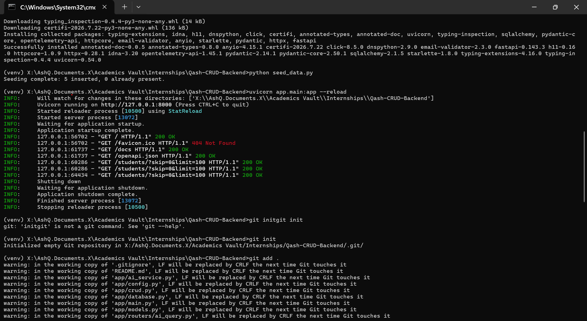

- API base URL: `http://127.0.0.1:8000`
- Interactive docs (Swagger UI): `http://127.0.0.1:8000/docs`
- The SQLite file `students.db` is created automatically on first run.

Optional environment variables: `DATABASE_URL` (default `sqlite:///./students.db`), `OLLAMA_BASE_URL` (default `http://localhost:11434`), `OLLAMA_MODEL` (default `llama3.2:1b`).

---

## 4. API Reference & Testing

Easiest: open **`/docs`** and use "Try it out". Or use `curl`:

*Complete API Overview: The Swagger UI dashboard displaying all available routes, including CRUD operations, the AI assistant, and the health check endpoint.*

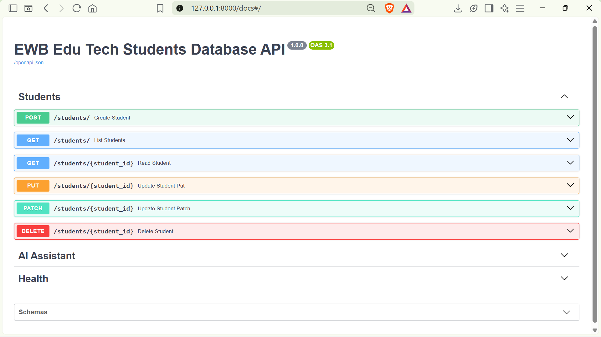

| Method | Endpoint | Description | Success | Errors |
|---|---|---|---|---|
| POST | `/students/` | Create a student | 201 | 409, 422 |
| GET | `/students/` | List students (`skip`, `limit`, `name`, `course`, `email`) | 200 | 422 |
| GET | `/students/{id}` | Get one student | 200 | 404 |
| PUT / PATCH | `/students/{id}` | Update (partial update; send only changed fields) | 200 | 404, 409, 422 |
| DELETE | `/students/{id}` | Delete a student | 204 | 404 |
| POST | `/ask` | Ask a question in plain English (needs Ollama) | 200 | 502, 503, 422 |

### Sample requests

**Create**
```bash
curl -X POST http://127.0.0.1:8000/students/ \
  -H "Content-Type: application/json" \
  -d '{"name":"Test Student","date_of_birth":"2003-04-05","email":"test.student@example.com","phone":"9000000099","course":"Computer Science"}'
```

**List with filter and pagination**
```bash
curl "http://127.0.0.1:8000/students/?course=computer&skip=0&limit=10"
```

**Get one**
```bash
curl http://127.0.0.1:8000/students/1
```

**Update (PATCH)**
```bash
curl -X PATCH http://127.0.0.1:8000/students/1 \
  -H "Content-Type: application/json" \
  -d '{"course":"Data Science"}'
```

**Delete**
```bash
curl -X DELETE http://127.0.0.1:8000/students/1
```

### Sample Requests & Validations

#### 1. Health Check (GET `/`)

*Testing the root GET `/` endpoint confirms the API is online and responding with a 200 OK status.*

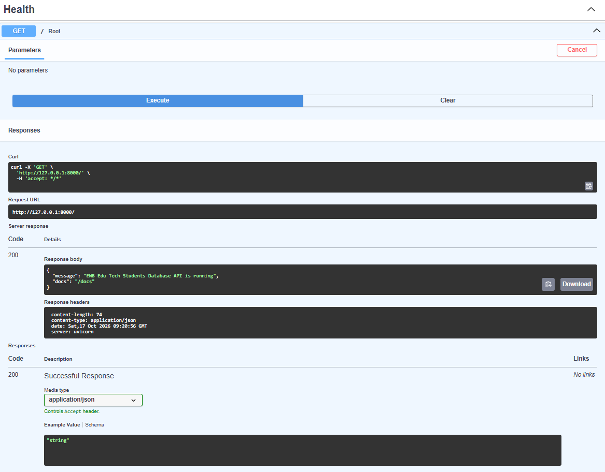

#### 2. Create (POST `/students/`)

*Validation Check: Submitting invalid data (like a raw "string" instead of a proper email) triggers the Pydantic validation layer, correctly rejecting the POST request with a 422 Unprocessable Content error to protect the database.*

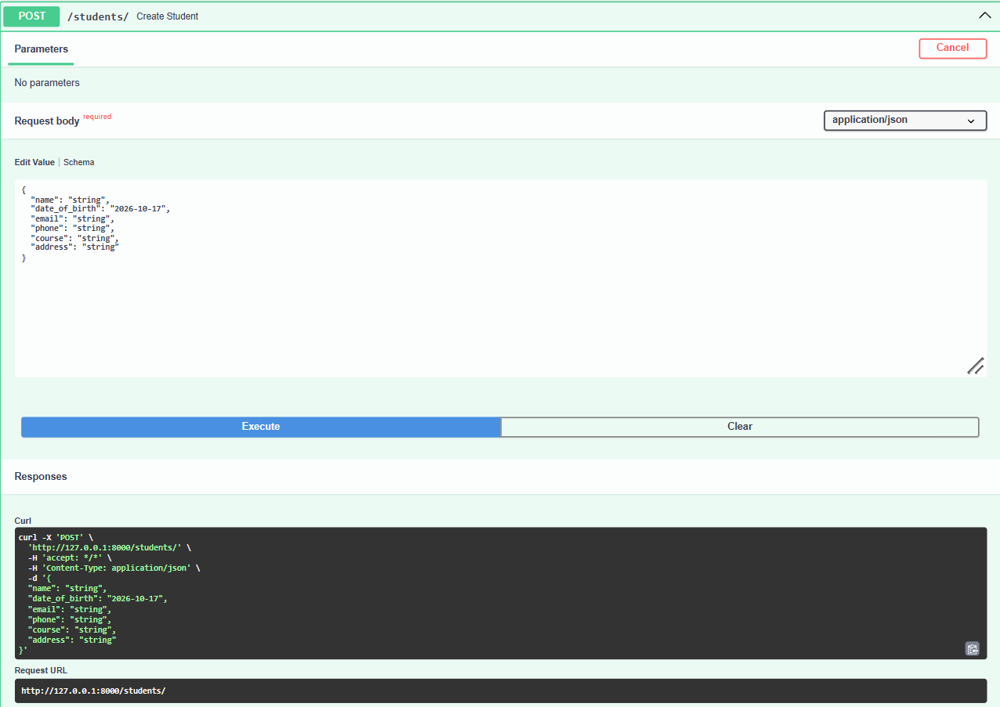
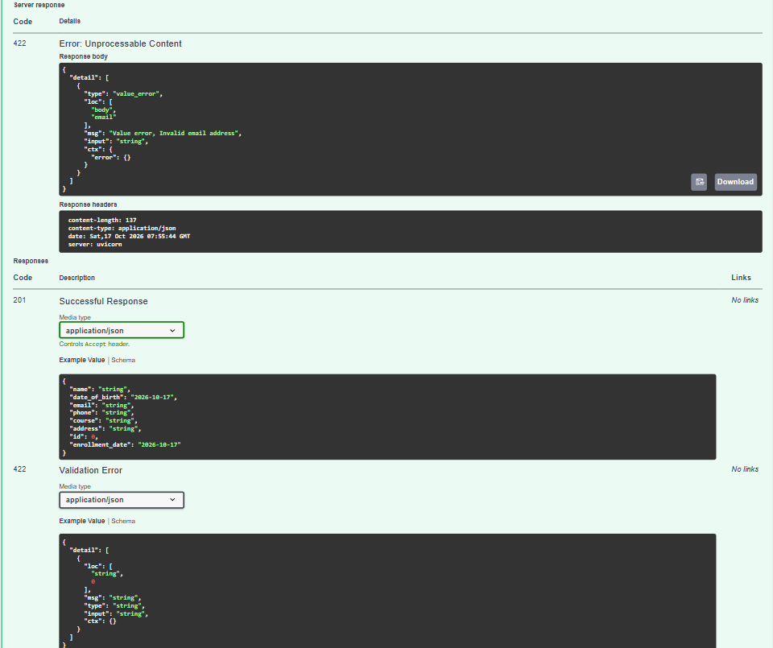

#### 3. List with Filter and Pagination (GET `/students/`)

*Testing the GET endpoint using query parameters (skip, limit, and specific field filters) successfully returns the requested filtered data with a 200 OK response.*

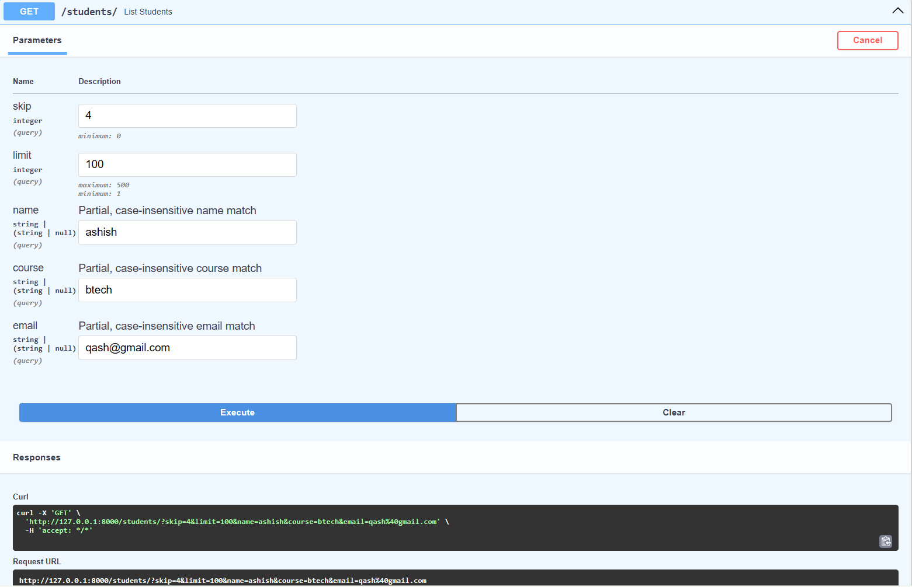
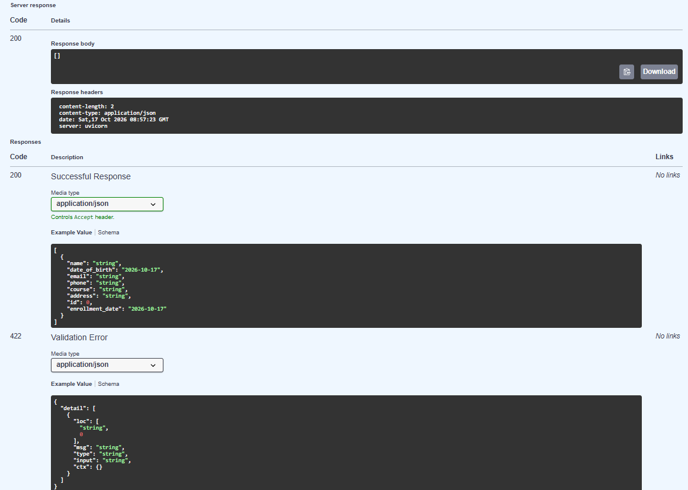

#### 4. Get One (GET `/students/{id}`)

*Fetching a specific student by their unique ID successfully retrieves the single record with a 200 OK status.*

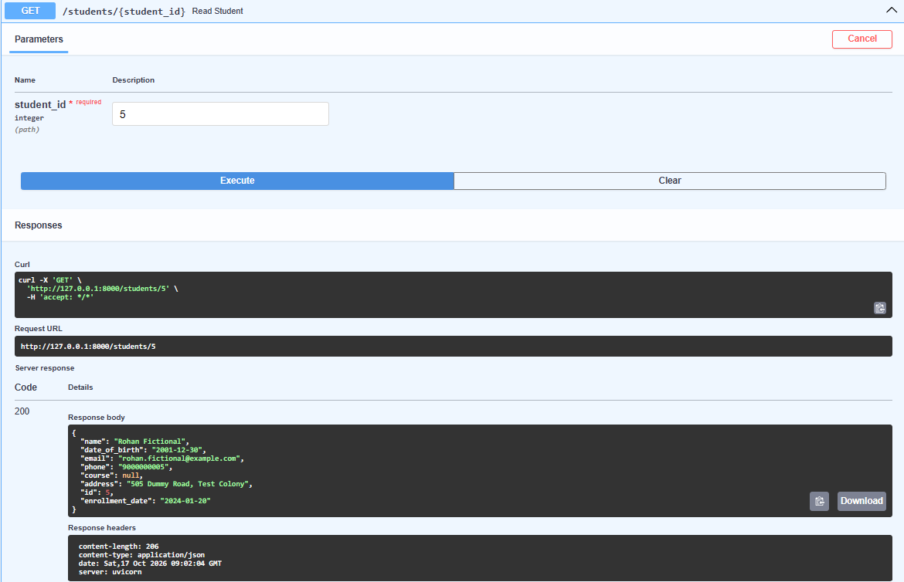
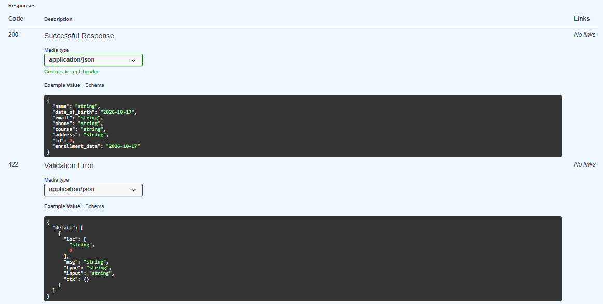

#### 5. Update (PATCH & PUT `/students/{id}`)

*Partial Update Validation: Testing the PATCH endpoint with malformed partial data successfully catches the invalid input and returns a 422 error.*

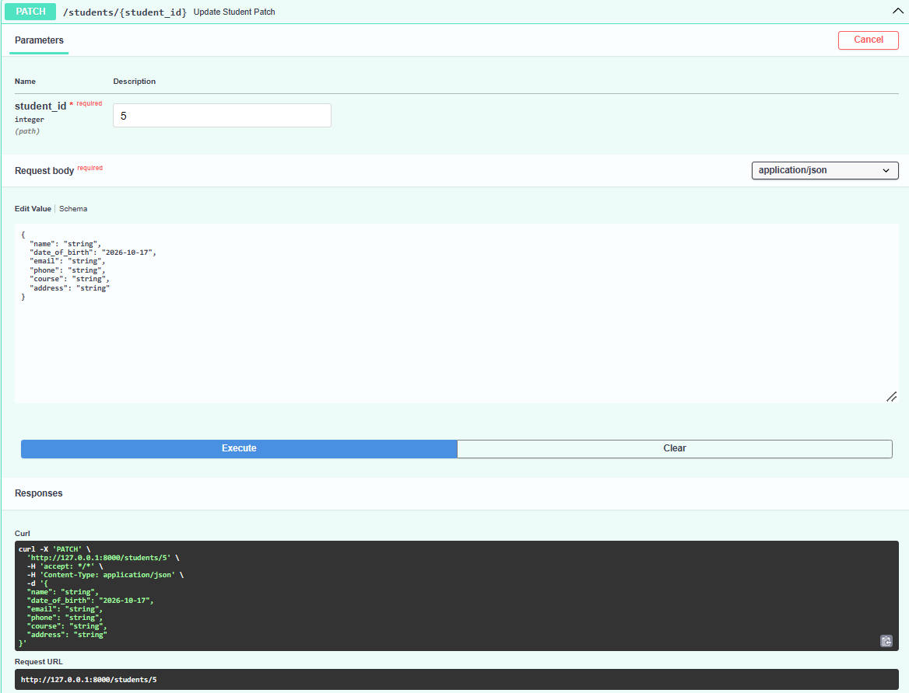
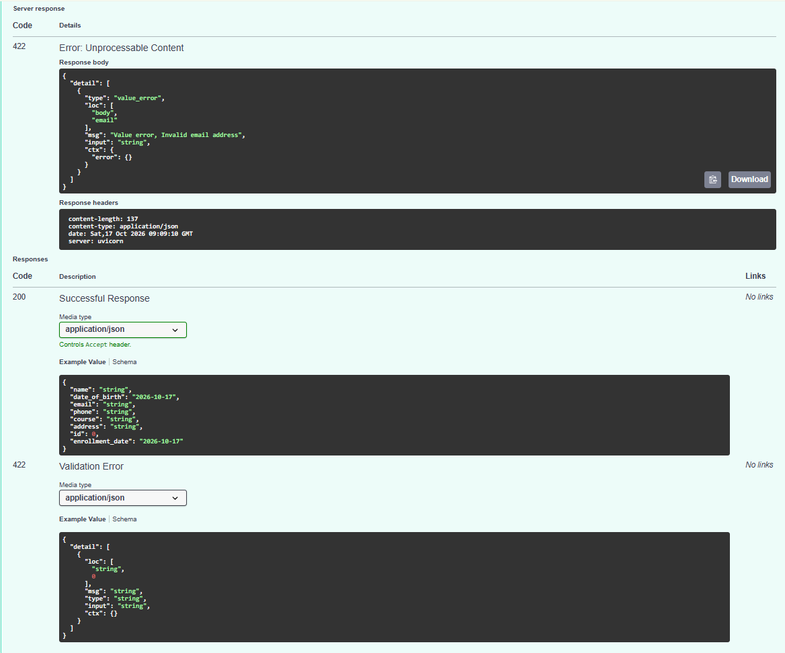

*Full Update Validation: Attempting a PUT request with improperly formatted email data correctly throws a 422 Unprocessable Content validation error as well.*

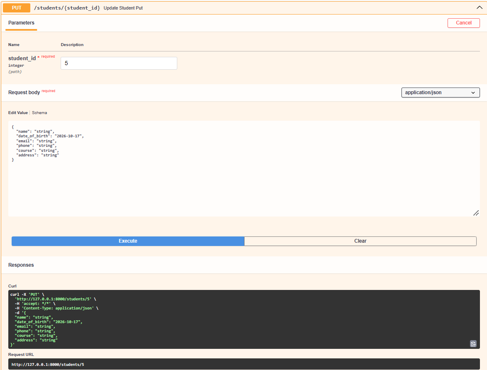
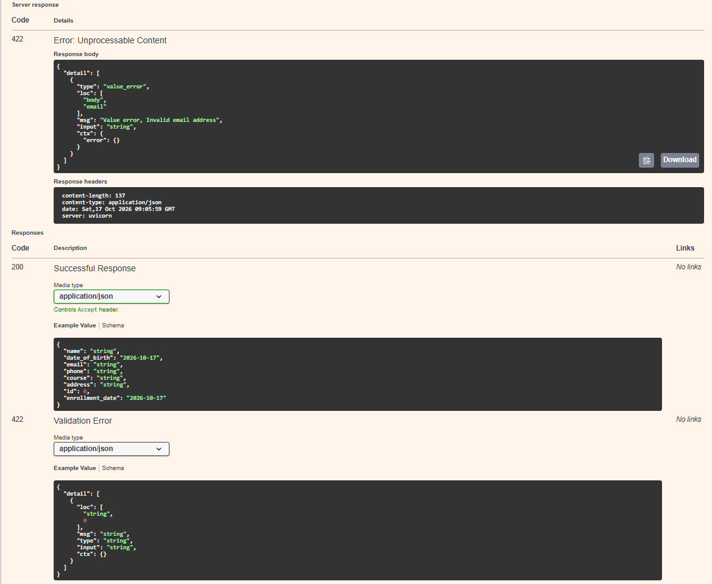

#### 6. Delete (DELETE `/students/{id}`)

*Successfully deleting a student record, which returns a clean 204 No Content response.*

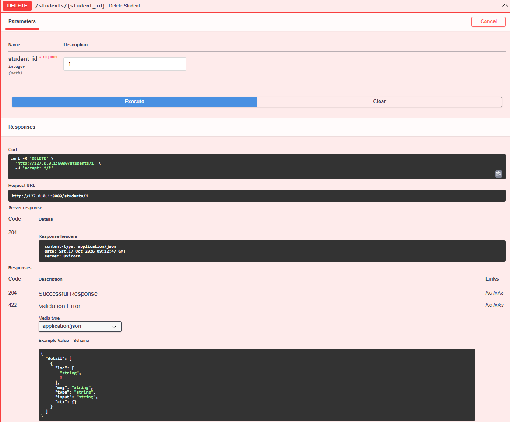

### Error-handling checks

1. **409:** run the *Create* request twice. The second call returns `409 Conflict` (duplicate email).
2. **404:** `curl -i http://127.0.0.1:8000/students/9999` returns `404 Not Found`.
3. **422:** create a student with `"email":"not-an-email"` and get a validation error.

---

## 5. Architecture (for the live demo)

```
app/
├── config.py          Settings (DB URL, Ollama URL/model) via os.getenv
├── database.py        SQLAlchemy engine, SessionLocal, Base, get_db() dependency
├── models.py          Student ORM model (table: students)
├── schemas.py         Pydantic v2 schemas: StudentBase/Create/Update/Out
├── crud.py            Data-access functions (no HTTP code)
├── ai_service.py      Ollama client + read-only context builder
├── main.py            App instance, table creation, router registration
└── routers/
    ├── students.py    CRUD endpoints
    └── ai_query.py    POST /ask
seed_data.py           Inserts 5 dummy records (idempotent)
```

**Request flow:** `Client → Router → Schema validation → CRUD function → SQLAlchemy → SQLite`

*Data Models & Schemas Reference: The underlying Pydantic schemas that enforce the strict structure for request and response payloads across the API layer.*

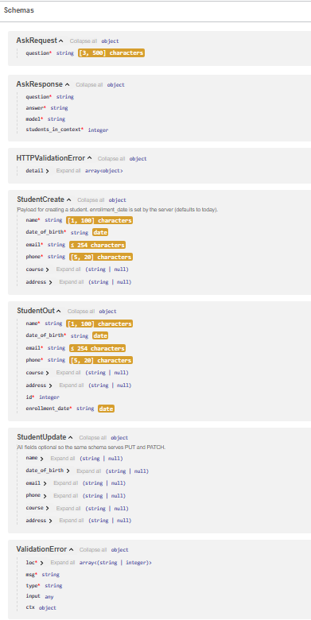

**Key design points**

- **Layered design.** Routers handle HTTP, `crud.py` handles data, `models.py` defines storage, and `schemas.py` validates input and output. Each layer has one job.
- **Error mapping.** `crud.py` returns `None` for a missing record and raises `DuplicateEmailError` for a duplicate email. The router converts these to 404 and 409. A database unique constraint is the backstop for concurrent requests.
- **PUT and PATCH.** Both apply a partial update using `exclude_unset=True`. Required fields cannot be nulled out.
- **Session handling.** `get_db()` gives each request its own session and always closes it.
- **AI safety.** The LLM never touches the database. `ai_service.build_context()` runs read-only ORM queries, turns the rows into JSON, and sends that JSON as data to Ollama. The model is told to answer only from that data. Model output is never executed as SQL or code.

---

## 6. Ollama Setup (`llama3.2:1b`) - Optional

The CRUD API works without Ollama. Only `POST /ask` needs it.

1. **Install Ollama:** download from <https://ollama.com/download> (macOS, Windows, Linux).
2. **Download the model** (about 1.3 GB):
   ```bash
   ollama pull llama3.2:1b
   ```
3. **Make sure the server is running** (the desktop app starts it automatically; otherwise run `ollama serve`). It listens on `http://localhost:11434`.
4. **Test the model:**
   ```bash
   ollama run llama3.2:1b "Say hello"
   ```
5. **Ask the API a question:**
   ```bash
   curl -X POST http://127.0.0.1:8000/ask \
     -H "Content-Type: application/json" \
     -d '{"question":"How many students are enrolled in each course?"}'
   ```

Example response:
```json
{
  "question": "How many students are enrolled in each course?",
  "answer": "...",
  "model": "llama3.2:1b",
  "students_in_context": 5
}
```

*AI Assistant Inactive Fallback Testing: The application is designed to gracefully handle scenarios where the optional AI service is unavailable. If a user queries the POST `/ask` endpoint while the local Ollama server is offline, the API safely catches the connection error and returns a handled 503 Service Unavailable response instead of crashing.*

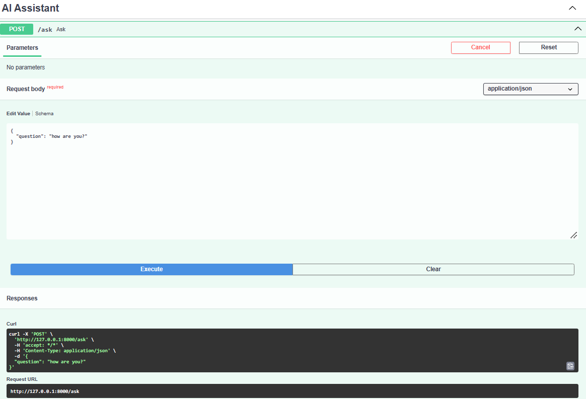
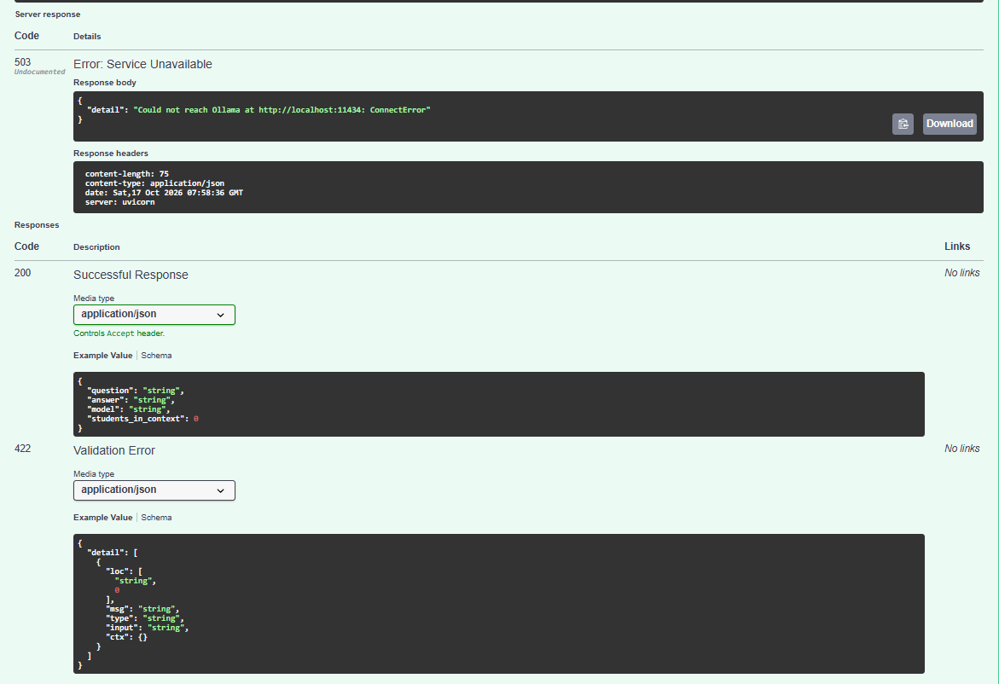

**Troubleshooting**

| Problem | Fix |
|---|---|
| `503 Could not reach Ollama` | Start Ollama (`ollama serve`) and check `OLLAMA_BASE_URL` |
| `502` from `/ask` | Run `ollama pull llama3.2:1b`, then retry |
| Slow first answer | The model loads into memory on first use; later calls are faster |

A 1B-parameter model is small, so keep questions simple (counts, lookups by name or course).
